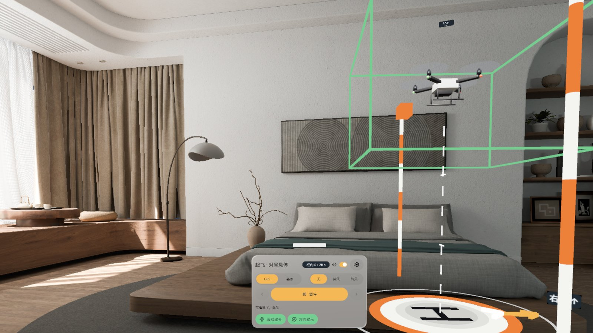
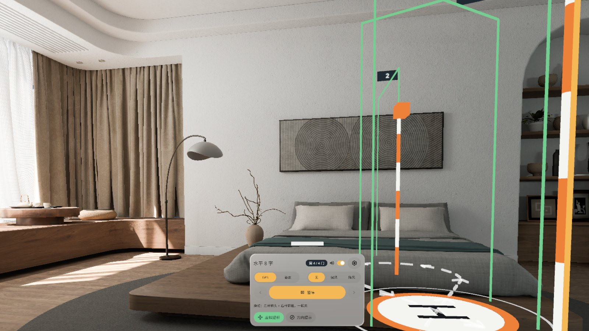
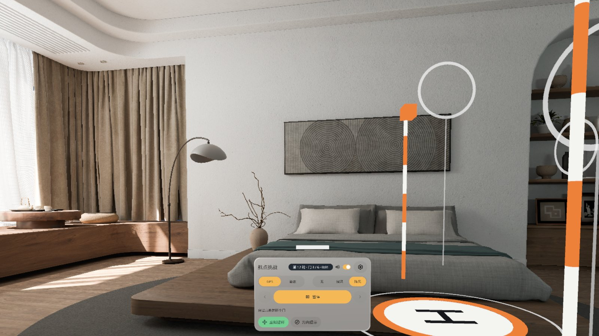
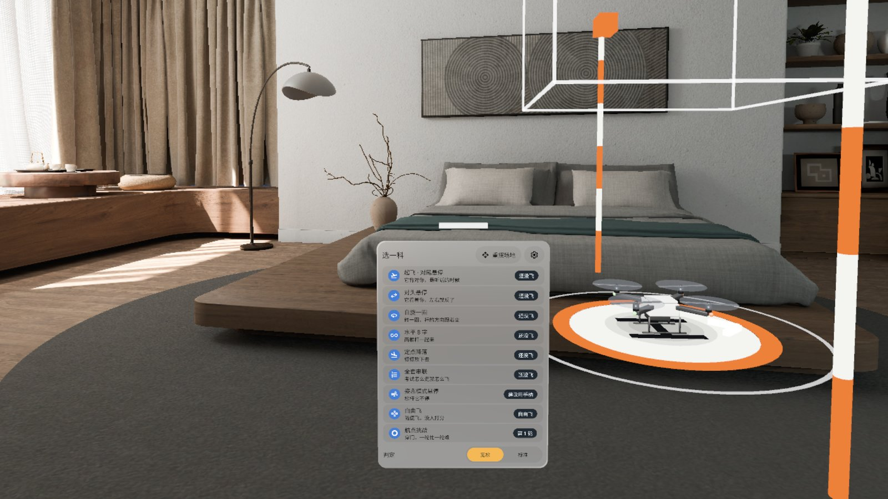

# Line-of-Sight Pilot 视距飞手

> **v0.1.1 · Pre-release · passed emulator QA, not yet verified on a headset**（预发布 · 模拟器 QA 通过，真机未验证）


[English](#english) · [中文](#中文)

---

## English

A life-size quadcopter (450 mm wheelbase) takes off from a pad on your real living-room floor. The two PICO controller thumbsticks are a Mode 2 transmitter: left stick = throttle and yaw, right stick = pitch and roll. Practise the multirotor visual-line-of-sight test items in exam order. The drone is real size in your real room, so you judge distance and height with your own eyes, and when the nose points at you, pushing right sends it to *your* left. That flip is the thing to practise. A PICO OS 6 passthrough (Mixed Stage) app built with the PICO Spatial SDK.

- **7 lessons** named and ordered after the CAAC multirotor VLOS practical test: Takeoff · tail-in hover, Nose-in hover, Slow 360, Figure eight (4 gates around two poles), Spot landing, Full run (all of it without landing), ATTI hover (attitude mode with a light breeze)
- **Free flight** and an endless **Waypoint run**: procedurally generated hoops (3–6 per round). Every hoop stays at least 1.5 m from your head and out of the panel's direction, and the set is redrawn if you move the panel
- **GPS / ATTI** modes (GPS stops when you let go, ATTI keeps drifting), wind off / light / gusty, lenient or standard judging
- The floor shadow, nose arrow and height tag show where the nose points and how high the drone is. Direction hints ("R stick →") are on for the first two lessons
- **No controllers?** Two virtual stick pads under the panel work with pinch-and-drag
- One control panel on your left (drag it, or call it back in Settings), Chinese / English, sound with mute, offline, no account, no permissions

**This is for stick feel only. It does not count as training hours and does not replace a licensed course or the exam.** Lesson names follow the CAAC test items; the course is scaled to a living room, not exam size.

### Screenshots (emulator, Chinese UI)

| | |
|---|---|
|  Tail-in hover: fly into the green box and hold for 20 s; arrows on the floor show which way to push |  Nose-in hover: the nose points at you, so left and right flip |
|  Slow 360: turn a full circle inside the box; the ring on the pad counts the degrees |  Figure eight: fly the painted line around both poles through 4 numbered gates |
|  Waypoint run: generated hoops in the course, kept away from your head and the panel |  Lessons: 7 test items in exam order, plus free flight and the waypoint run |

Screenshots come from the PICO emulator, with states reached by debug broadcasts and cropped to 16:9. The emulator camera cannot turn, so the panel (which sits 38° to your left by default) was brought in front of the camera for these shots. The release also carries a demo video (`LineOfSightPilot-demo.mp4`, 60 s, English UI). It is a native emulator run **driven by debug input, not a recording of real hands or controllers**, has no sound, and plays at about 1 frame per second, so the flight looks jumpy.

### Install

```bash
adb install -r LineOfSightPilot-v0.1.1.apk
pico-cli app launch io.embodit.dronesight
```

Get the APK from [Release v0.1.1](https://github.com/kejing-dev/LineOfSightPilot/releases/tag/v0.1.1). Requires PICO OS 6 (Spatial SDK 6.1.9, minSdk 35). The APK is a debug build (versionCode 2).

### Not yet verified on a headset

Emulator QA round 3 passed all three gates: no Material components; install, launch and 60 s with no crash or ANR; all 17 design states checked in Chinese and English, 108 screenshots. Both round-2 blockers are fixed: lesson titles were cut off with "…" when the timer chip grew, and waypoint hoops were generated from a default head pose and could land in front of the panel. No headset was connected when this was published, so a person still needs to check on a real PICO:

1. Install v0.1.1 and cold-start 3 times. Within 2 s the panel should be at 38° left and the course ahead. Also start once looking down 30° and once looking up 30°: the panel should be upright and facing you.
2. Mode 2 sticks: left = throttle + yaw, right = pitch + roll, with the right signs on every axis. Holding the left stick up for 1 s takes off; A / X pauses. Check the dead zone and expo feel.
3. Press every panel button with the controller ray and with eye + pinch. In S03, place the course with the ray and confirm with the trigger; the course should then lock. Pinch-drag the virtual stick pads and check they follow your hand.
4. Waypoint run: stand at different spots and turn the course to an angle before starting F2. No hoop should land in the panel's direction or right in your face, and hoops should be rearranged when the panel is dragged before take-off.
5. Judging distance at 1:1: the 0.45 m quad is easy to see 3 m away, **both lines of the height tag can be read at 3 m**, and the shadow shows on a dark carpet.
6. In nose-in hover the direction hint points to your left. Fly L1, L2 and L5 sloppily 3 times each with real controllers; they should still pass.
7. Turn 90° and 180°, then use "call the panel back": it appears in your new straight-ahead direction. A dragged panel stays where you let go.
8. Sound: 3 minutes of flying with sound on is not annoying; the mute switch is easy to find and is remembered; rotor sound is loud enough at 1–3 m.
9. Settings → Quit app → Quit: the app leaves recents and reopens clean. **The text on the danger keys and on "Cancel" is easy to read.**

### Known issues (non-blocking)

1. The grey "Cancel" key in the quit dialog measured 4.44–4.49 : 1 on emulator screenshots, just under 4.5 : 1 (this method reads small text low; the same key measured 5.35 : 1 last round). Check it on the headset.
2. The height tag sits over the drone 3 m away. In emulator screenshots its second line (tail-in / nose-in / side) is only about 6 px tall, too small to read. The text-fit log shows it is not clipped; readability needs a headset.
3. By default the control panel is 38° to your left (decided at design gate B). Check on a headset that turning your head to it is comfortable.
4. The short states S00 (getting ready, under 2 s), S07 (landing check, 1.2 s) and S09 (hard landing, 2.0 s) only have log evidence, no screenshots: the emulator draws about 1 frame per second. The state changes and result cards are correct in the logs.
5. The demo video is recorded at about 1 fps on the emulator, so the flight looks jumpy. It is also in English.
6. Debug tools only (does not affect users): `fly hover` leaves the drone side-on once the course has been turned, and `tools/pad_lesson.sh` times out at slow speed on this emulator.

### Development

Kotlin · PICO Spatial SDK 6.1.9 · Mixed Stage (`STAGE_MIXED`, passthrough) with one control panel, optional virtual stick pads, a height tag over the drone and a blocking dialog. See [AGENTS.md](AGENTS.md) for structure, debug broadcasts, the text-fit gate and the QA hooks. Flight model, judging, waypoints and layout are plain Kotlin with JVM tests (`tools/dev.sh test`, 52 tests).

### Credits

- Quadcopter: built by the developer in Blender with a procedural `bpy` script (a white 450-class trainer with red front / green rear LEDs). No third-party model or licence involved.
- Course, pad, poles, gates, shadow and arrows are built in code; rotor and cue sounds are synthesised in code (`tools/render_audio.py`).
- Fonts: Noto Sans / Noto Sans SC subset, SIL OFL 1.1 (`third_party/`).
- Icons: Material Symbols (UI glyphs), Apache-2.0.
- Reference apps, with thanks: [Spatial Chopper Toy](https://github.com/EE-LiuYunhao/SpatialChopperToy) by EE-LiuYunhao (Mixed Stage set-up and the velocity / drag flight-solver idea, simplified here; that repository has no licence file, so confirm before making this repository public); and the developer's own Furniture Fit (controller thumbstick reading), Spatial Ruler (floor tracking, head tracker, panel pool, fonts) and Figure Model (fixed draggable panel with call-back, floor shadow, debug receiver). Panel pool, theme and debug receiver were ported from Dog Manners, from the same factory.

---

## 中文

一架真实大小的四轴（轴距 450 mm）停在你客厅真实地板上的起降垫上。两只 PICO 手柄的摇杆就是 Mode 2 遥控器：左杆管油门和机头，右杆管前后左右。按执照考试的顺序练视距科目。飞机是真尺寸、在真房间里飞，远近高低靠你自己的眼睛判断。机头朝你的时候，右杆往右，飞机往**你的**左边走，这一下就是要练的。PICO OS 6 透视应用（Mixed Stage），PICO Spatial SDK 开发。

- **7 课**，名字和顺序对照 CAAC 多旋翼视距内驾驶员实践考试：起飞 · 对尾悬停、对头悬停、自旋一圈、水平 8 字（绕两根桩穿 4 道门）、定点降落、全套串联（中间不落地）、姿态模式悬停（姿态模式 + 微风）
- **自由飞**和不限轮次的**航点挑战**：程序生成的悬空圆门，每轮 3–6 个。每个门离你的头至少 1.5 米、不进面板方向；挪了面板会重新生成
- **GPS / 姿态**两档（GPS 松杆就停，姿态松杆会飘），风分无 / 微风 / 阵风，判定分宽松 / 标准
- 地上的影子、机头箭头和高度牌告诉你机头朝哪、飞多高；前两课默认开方向提示（「右杆 →」）
- **没手柄**：面板下方两块虚拟摇杆垫，捏住拖也能飞
- 一块控制面板在你左手边（可拖，设置里可叫回），中英双语，声音可静音，不联网，不需要账号，不申请权限

**这是练手感用的，不算培训学时，不能替代正规培训和考试。**科目名称对照 CAAC 考试科目，场地按客厅缩放，不是考场尺寸。

### 截图（模拟器，中文界面）

见上方截图表：

1. 对尾悬停：飞进绿框悬停 20 秒，地上的箭头提示往哪推杆
2. 对头悬停：机头对着你，左右反过来
3. 自旋一圈：在框里原地转满一圈，垫子上的刻度环记角度
4. 水平 8 字：沿地上的 8 字线绕两根桩，依次穿过 4 道门
5. 航点挑战：程序生成的悬空圆门，离你的头和面板都远
6. 选科：7 课按执照考试科目顺序，外加自由飞和航点挑战

截图来自 PICO 模拟器，状态用调试广播定住拍摄，裁成 16:9。模拟器镜头不能转头，所以默认在你左手边 38° 的面板是挪到镜头正前方拍的。Release 里还有一段演示视频（`LineOfSightPilot-demo.mp4`，60 秒，英文界面），是原生模拟器演示，**由调试输入驱动，非真实手势录像**，无声。模拟器约 1 帧 / 秒，所以飞行看起来跳帧。

### 安装

```bash
adb install -r LineOfSightPilot-v0.1.1.apk
pico-cli app launch io.embodit.dronesight
```

APK 在 [Release v0.1.1](https://github.com/kejing-dev/LineOfSightPilot/releases/tag/v0.1.1)。需要 PICO OS 6（Spatial SDK 6.1.9，minSdk 35）。APK 是 debug 构建（versionCode 2）。

### 模拟器 QA 通过，真机未验证

模拟器 QA 第 3 轮三道门禁全过：无 Material 组件；装机、启动、60 秒无崩溃 / ANR；设计包 17 个状态中英各核对一遍，共 108 张截图。第 2 轮的两条阻断都修好了：计时 chip 变宽时科目名被省略号截断；航点门按默认头位置生成，可能挡在面板前。发布时头显没连，下面这些要戴上头显人工看：

1. 装 v0.1.1，冷启动 3 次：2 秒内面板在左 38°、场地在前方；再低头 30°、抬头 30° 各启动一次，面板竖直、正对你。
2. Mode 2 双摇杆：左杆油门 + 航向、右杆俯仰 + 横滚，每个轴方向都对；左杆上推 1 秒起飞；A / X 暂停；死区和 expo 手感。
3. 手柄射线和眼手捏合各点一遍面板所有按钮；S03 用射线落点摆场地、扳机确认后锁住；虚拟摇杆垫用眼手捏住拖，看是否跟手。
4. 航点挑战：站在场地不同位置、把场地转一个角度后开 F2，门不进面板方向、穿门时不贴脸；起飞前拖面板后门会重排。
5. 1:1 判距离：0.45 米轴距的四轴在 3 米外看得清，**高度牌两行在 3 米外都读得出**，影子在深色地毯上看得见。
6. 对头悬停时方向提示指向你的左侧；L1 / L2 / L5 用真手柄各故意马虎 3 次都能过。
7. 转身 90° / 180° 后「叫回面板」出现在新的正前方；面板拖动后停在松手处。
8. 开声音连飞 3 分钟不吵，静音开关一眼可见并记住；1–3 米外旋翼声够响。
9. 设置 → 退出应用 → 退出：从最近任务消失，再启动干净；**危险键和「取消」的字读得清**。

### 已知问题（不挡用）

1. 退出确认里灰色「取消」键在模拟器截图上量到 4.44–4.49 : 1，略低于 4.5 : 1（这种量法对小字偏低，上一轮同一个键量到 5.35 : 1），请真机复看。
2. 高度牌在 3 米外的飞机上方，模拟器截图里第二行（对尾 / 对头 / 侧向）只有约 6 像素高，读不出；溢出日志 0 条，字没被裁，能不能读要真机看。
3. 控制面板默认在左 38°（设计门 B 定的），要真机确认转头看面板舒服。
4. S00（准备中，不到 2 秒）、S07（着陆判定，1.2 秒）、S09（硬着陆，2.0 秒）只有日志、没有截图：模拟器约 1 帧 / 秒，截不到这么短的过渡。日志里状态切换和结果卡都对。
5. 演示视频是模拟器约 1 fps 录的，飞行看起来跳帧；视频是英文界面。
6. 只影响调试工具、不影响用户：场地转过角度后 `fly hover` 让飞机侧对你；`tools/pad_lesson.sh` 在本机慢速时超时。

### 开发

Kotlin · PICO Spatial SDK 6.1.9 · Mixed Stage（`STAGE_MIXED`，透视），一块控制面板、可开关的虚拟摇杆垫、飞机上方的高度牌和一个无法使用对话框。结构、调试广播、文字溢出门禁、QA 钩子见 [AGENTS.md](AGENTS.md)。飞行模型、判定、航点和摆放是纯 Kotlin，带 JVM 单测（`tools/dev.sh test`，52 个）。

### 致谢与许可

- 四轴模型：开发者用 Blender `bpy` 脚本程序化建模（白色 450 级训练机，前红后绿 LED），没有第三方模型、没有外部许可问题。
- 场地、起降垫、桩、门、影子和箭头由代码生成；旋翼声和提示音由代码合成（`tools/render_audio.py`）。
- 字体：Noto Sans / Noto Sans SC 子集，SIL OFL 1.1（`third_party/`）。
- 图标：Material Symbols（界面图标），Apache-2.0。
- 参考应用，致谢：EE-LiuYunhao 的 [Spatial Chopper Toy](https://github.com/EE-LiuYunhao/SpatialChopperToy)（Mixed Stage 启动、速度 + 阻力的飞行解算思路，本应用做了简化；该仓库没有许可文件，本仓库公开前要先确认）；开发者自己的 Furniture Fit（手柄摇杆读取）、Spatial Ruler（地面检测、头部追踪、面板池、字体）、Figure Model（固定可拖面板与叫回、地面影子、调试接收器）。面板池、主题和调试接收器移植自同一条产线的 Dog Manners。
