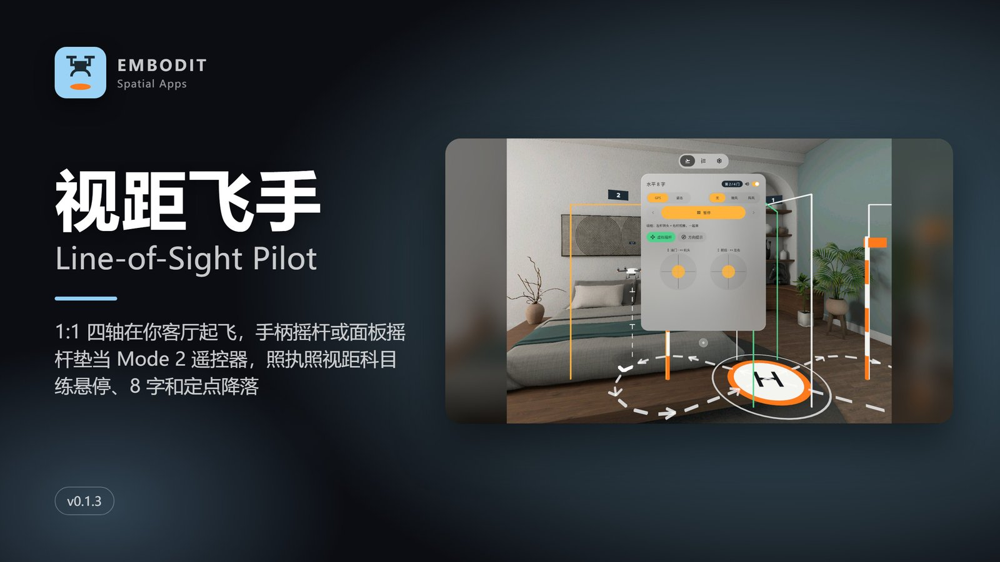
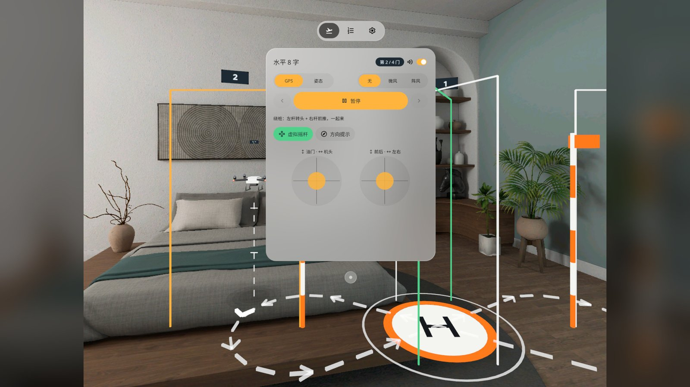
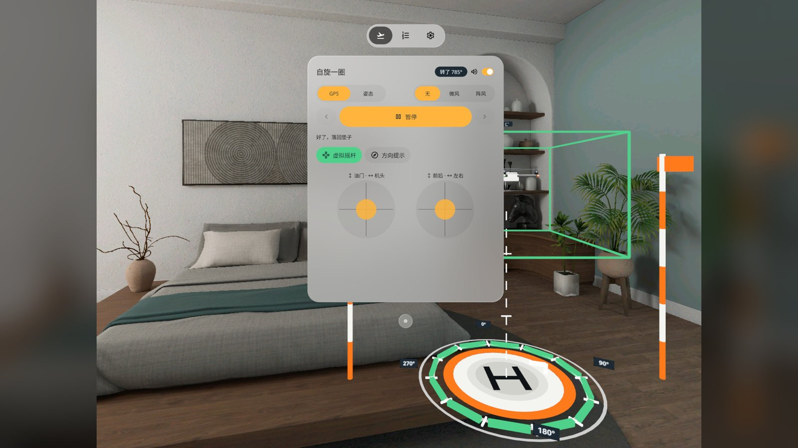
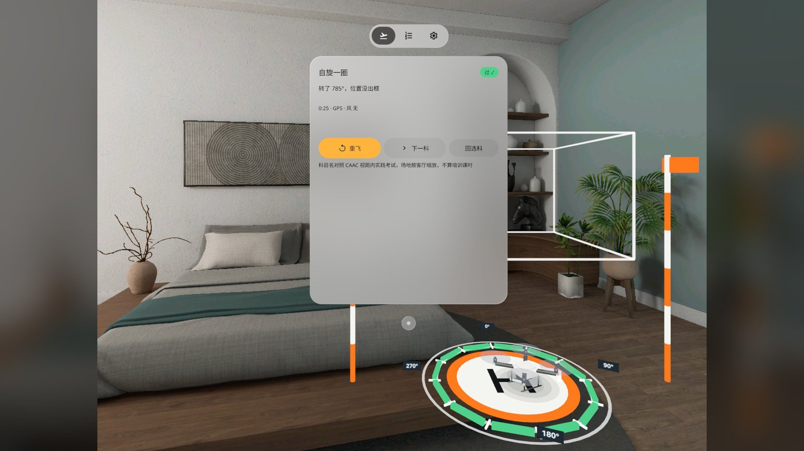
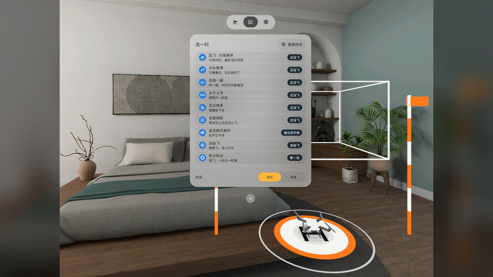
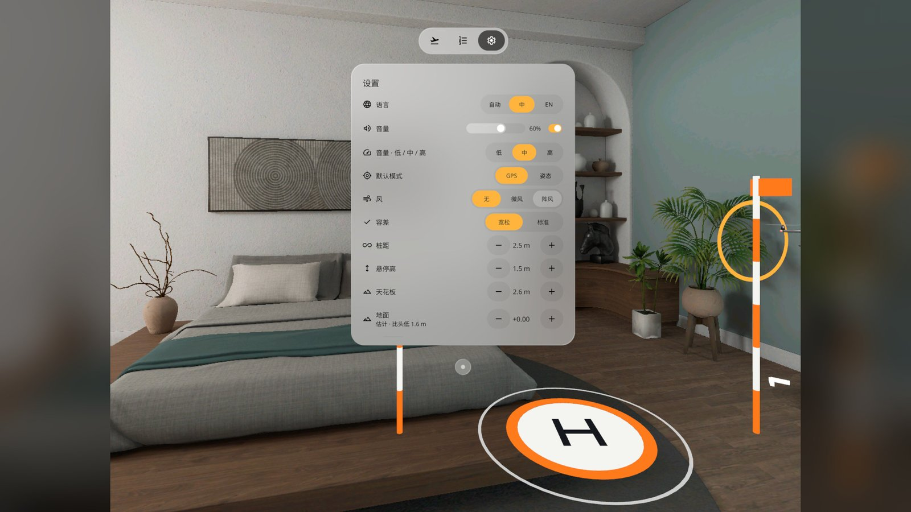
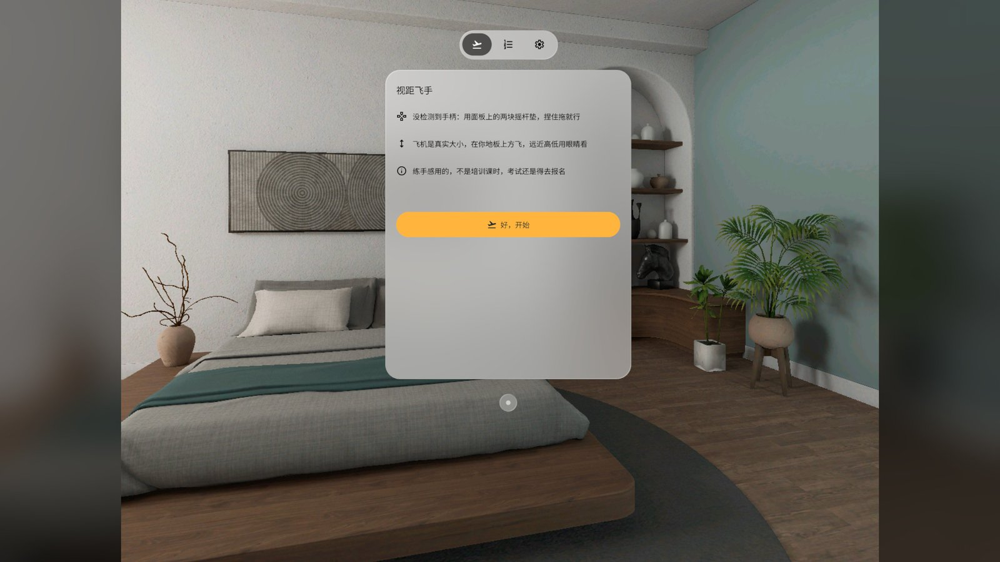

# Line-of-Sight Pilot 视距飞手

> **v0.1.3 · Release · emulator QA passed, accepted on a PICO headset**（正式版 · 模拟器 QA 通过，用户头显验收放行）




[English](#english) · [中文](#中文)

---

## English

A life-size quadcopter (450 mm wheelbase) takes off from a pad on your real living-room floor. The two PICO controller thumbsticks are a Mode 2 transmitter: left stick = throttle and yaw, right stick = pitch and roll. Practise the multirotor visual-line-of-sight test items in exam order. The drone is real size in your real room, so you judge distance and height with your own eyes, and when the nose points at you, pushing right sends it to *your* left. That flip is the thing to practise. A PICO OS 6 passthrough (Mixed Stage) app built with the PICO Spatial SDK.

- **7 lessons** named and ordered after the CAAC multirotor VLOS practical test: Takeoff · tail-in hover, Nose-in hover, Slow 360, Figure eight (4 gates around two poles), Spot landing, Full run (all of it without landing), ATTI hover (attitude mode with a light breeze)
- **Free flight** and an endless **Waypoint run**: procedurally generated hoops (3–6 per round), kept at least 1.5 m from your head and out of the panel's direction
- **GPS / ATTI** modes (GPS stops when you let go, ATTI keeps drifting), wind off / light / gusty, lenient or standard judging
- The floor shadow, nose arrow and height tag show where the nose points and how high the drone is. Direction hints on the floor ("R stick →") are on for the first two lessons
- **No controllers?** Two virtual stick pads in the panel work with pinch-and-drag
- One system window with a TabBar (Fly / Lessons / Settings) that you can drag; close it and a small "Open panel" button stays in the room
- Rotor sound synthesised live: four rotors with their own harmonics, pitch follows the throttle and drifts a little, no hiss
- Chinese / English / follow system, switched on the first row of Settings and applied at once (the 3D stick labels too); Quit app at the bottom of Settings; offline, no account, no permissions

**This is for stick feel only. It does not count as training hours and does not replace a licensed course or the exam.** Lesson names follow the CAAC test items; the course is scaled to a living room, not exam size.

### What's new in v0.1.3 (since v0.1.1)

From the user's headset feedback on v0.1.1 ("same UI problem; the rotor sound is a bit monotonous, add random pitch and make it more harmonious; add bilingual and a quit button; use the native TabBar"):

- The three attached panels (control panel, stick pads, blocking dialog) and the home-made drag bar are replaced by **one system window + native TabBar**. Drag it by the system handle; × leaves an "Open panel" button; Settings can call it back in front of you.
- **Rotor sound** is now synthesised in real time instead of a 1 s loop: per-rotor harmonics, pitch 170–290 Hz with throttle, slow random drift (±2.5 %), slight detune between rotors, distance roll-off.
- **Language** is the first row of Settings: Auto / 中 / EN, applied immediately. The 3D stick labels on the floor follow the switch mid-flight (QA #4 q4-2).
- **Quit app** is at the bottom of Settings with an in-place confirm; "Cancel" now reads at 10 : 1 (QA #4 q4-1).
- **The window opens only when your head is level** (within ±10°). Looking down or up, you see "Look straight ahead" first; the platform otherwise opens the window tilted with your head (QA #4 q4-3).

### Screenshots (emulator, Chinese UI)

| | |
|---|---|
|  Figure eight: fly the painted line around both poles through 4 numbered gates (gate 2 of 4) |  Nose-in hover: the nose points at you, so the floor labels show "R stick →" and "R stick ↑" |
|  Slow 360: turn inside the box; the ring on the pad fills green with the degrees turned |  Result: passed, with retry, next lesson and back to lessons |
|  Lessons tab: 7 test items in exam order, plus free flight and the waypoint run |  Settings tab: language first, then volume, default mode, wind, judging, pole distance, hover height |
|  Welcome: no controller found, so fly with the stick pads | |

Screenshots were taken on the PICO emulator (v0.1.3, Chinese UI), with states reached by debug broadcasts; the emulator view is square, so each shot is centred on a 16:9 blurred background. The release also has a demo video (`video-01.mp4`, 80 s, Chinese UI): a native emulator run **driven by debug input, not a recording of real hands or controllers**, no sound, and the emulator draws about 1 frame per second, so the flight looks jumpy.

### Install

```bash
adb install -r LineOfSightPilot-v0.1.3.apk
pico-cli app launch io.embodit.dronesight
```

Get the APK from [Release v0.1.3](https://github.com/kejing-dev/LineOfSightPilot/releases/tag/v0.1.3). Requires PICO OS 6 (Spatial SDK 6.1.9, minSdk 35). The APK is a debug build (versionCode 4), the same file that is installed on the test headset. A build from another machine is signed differently: `adb uninstall io.embodit.dronesight` first (progress resets).

### Verification

- Emulator QA round 5 passed: the three QA #4 blockers are fixed, regression on the system window, TabBar, quit, lessons L1 / L3 / L4 / L5 and text fit (0 overflows in both languages) passed. The rotor sound was recorded in flight: pitch follows the throttle 207–292 Hz, no energy above 2 kHz, no clicks or loop seam.
- The user tried v0.1.3 on a PICO headset and released it (2026-11-05).
- Not measured: the hardware Mode 2 sticks on the emulator (no controller provider there), and how the ±10° level gate feels when you wear the headset.

### Known issues (non-blocking)

1. When the window opens near the edge of the level gate (±7–10°) it sits a little low and tilted. With the default course, the drone in L2 hover can be half behind the window's right edge; drag the window aside.
2. The window position is an estimate from the moment it opened. The app cannot read where you drag it, so waypoint avoidance and "drone behind the panel" fading use the first position. The left pole of the figure eight and some waypoints can end up behind the window: drag it aside.
3. The subtitle on the "Look straight ahead" hint is small (about 0.55°).
4. The rotor sound changes with throttle only; yaw, roll and pitch do not change it.
5. The last sample of the `ding` cue is not zero, so its tail is cut very slightly.
6. The TabBar shows icons only until you look at it (system behaviour).
7. Emulator only: the first frame of the window can show a black band; it recovers on the next redraw.

### Development

Kotlin · PICO Spatial SDK 6.1.9 · Mixed Stage (`STAGE_MIXED`, passthrough) with one Planar system window (540 × 680 dp) and a TabBar, a height tag over the drone and an "Open panel" button. See [AGENTS.md](AGENTS.md) for structure, debug broadcasts, the text-fit gate and the QA hooks. Flight model, judging, waypoints, rotor synth and layout are plain Kotlin with JVM tests (`tools/dev.sh test`).

### Credits

- Quadcopter: built by the developer in Blender with a procedural `bpy` script (a white 450-class trainer with red front / green rear LEDs). No third-party model.
- Course, pad, poles, gates, shadow and arrows are built in code; rotor sound is synthesised at run time and cue sounds by `tools/render_audio.py`.
- Fonts: Noto Sans / Noto Sans SC subset, SIL OFL 1.1 (`third_party/`).
- Icons: Material Symbols (UI glyphs), Apache-2.0.
- Reference apps, with thanks: [Spatial Chopper Toy](https://github.com/EE-LiuYunhao/SpatialChopperToy) by EE-LiuYunhao (Mixed Stage set-up and the velocity / drag flight-solver idea, simplified here; that repository has no licence file); and the developer's own Furniture Fit (controller thumbstick reading), Spatial Ruler (floor tracking, head tracker, fonts) and Figure Model (floor shadow, debug receiver). Theme and debug receiver were ported from Dog Manners, from the same factory.

---

## 中文

一架真实大小的四轴（轴距 450 mm）停在你客厅真实地板上的起降垫上。两只 PICO 手柄的摇杆就是 Mode 2 遥控器：左杆管油门和机头，右杆管前后左右。按执照考试的顺序练视距科目。飞机是真尺寸、在真房间里飞，远近高低靠你自己的眼睛判断。机头朝你的时候，右杆往右，飞机往**你的**左边走，这一下就是要练的。PICO OS 6 透视应用（Mixed Stage），PICO Spatial SDK 开发。

- **7 课**，名字和顺序对照 CAAC 多旋翼视距内驾驶员实践考试：起飞 · 对尾悬停、对头悬停、自旋一圈、水平 8 字（绕两根桩穿 4 道门）、定点降落、全套串联（中间不落地）、姿态模式悬停（姿态模式 + 微风）
- **自由飞**和不限轮次的**航点挑战**：程序生成的悬空圆门，每轮 3–6 个，离你的头至少 1.5 米、不进面板方向
- **GPS / 姿态**两档（GPS 松杆就停，姿态松杆会飘），风分无 / 微风 / 阵风，判定分宽松 / 标准
- 地上的影子、机头箭头和高度牌告诉你机头朝哪、飞多高；前两课地上有方向提示（「右杆 →」）
- **没手柄**：面板里两块虚拟摇杆垫，捏住拖也能飞
- 一个系统窗口 + 标签栏（飞行 / 科目 / 设置），可拖；点 × 关掉后房间里留一个「打开面板」小按钮
- 螺旋桨声实时合成：四个桨各有谐波，音高跟油门、带一点随机漂移，没有嘶声
- 设置第一行切语言：自动 / 中 / EN，立即生效（地上的 3D 摇杆牌也跟着换）；设置最底「退出应用」；不联网，不需要账号，不申请权限

**这是练手感用的，不算培训学时，不能替代正规培训和考试。**科目名称对照 CAAC 考试科目，场地按客厅缩放，不是考场尺寸。

### v0.1.3 改了什么（相对 v0.1.1）

来自用户在头显上试 v0.1.1 的反馈（「也是那个 UI 问题，然后飞机的螺旋桨声音现在有点单调噪音，可以加点随机 pitch 等，也再和谐一点，另外加个双语和退出按钮；用原生 tab bar 组件」）：

- 三块附着面板（控制面板、摇杆垫、拦截对话框）和自制拖动条，换成**一个系统窗口 + 原生标签栏**。用系统把手拖动；× 关掉后留「打开面板」；设置里可以把它叫回到你正前方。
- **螺旋桨声**从 1 秒循环改成实时合成：每个桨自己的谐波，音高随油门 170–290 Hz，缓慢随机漂移（±2.5 %），四个桨略微失谐，距离越远越轻。
- **语言**在设置第一行：自动 / 中 / EN，切了立即生效；飞行中切语言，地上的 3D 摇杆牌当场变（QA #4 q4-2）。
- **退出应用**在设置最底，同一页展开确认；「取消」对比度 10 : 1（QA #4 q4-1）。
- **只在你平视时打开窗口**（±10° 内）。低头或抬头时先看到「平视前方」提示，放平后窗口才出来，否则系统会把窗口跟着头俯着 / 仰着打开（QA #4 q4-3）。

### 截图（模拟器，中文界面）

见上方截图表：

1. 水平 8 字：沿地上的 8 字线绕两根桩，依次穿过 4 道门（第 2 / 4 门）
2. 对头悬停：机头对着你，地上的牌子提示「右杆 →」「右杆 ↑」
3. 自旋一圈：在框里原地转，垫子上的刻度环按转过的角度变绿
4. 结果：过了，可以重飞、下一科或回选科
5. 科目页：7 课按执照考试科目顺序，外加自由飞和航点挑战
6. 设置页：语言在第一行，下面是音量、默认模式、风、判定、桩距、悬停高
7. 欢迎页：没检测到手柄，用面板上的两块摇杆垫

截图来自 PICO 模拟器（v0.1.3，中文界面），状态用调试广播定住拍摄；模拟器画面是方的，所以居中放在 16:9 的模糊背景上。Release 里还有一段演示视频（`video-01.mp4`，80 秒，中文界面），是原生模拟器演示，**由调试输入驱动，非真实手势录像**，无声；模拟器约 1 帧 / 秒，所以飞行看起来跳帧。

### 安装

```bash
adb install -r LineOfSightPilot-v0.1.3.apk
pico-cli app launch io.embodit.dronesight
```

APK 在 [Release v0.1.3](https://github.com/kejing-dev/LineOfSightPilot/releases/tag/v0.1.3)。需要 PICO OS 6（Spatial SDK 6.1.9，minSdk 35）。APK 是 debug 构建（versionCode 4），和测试头显上装的是同一个文件。别的电脑构建的签名不同，要先 `adb uninstall io.embodit.dronesight`（进度会清零）。

### 验证

- 模拟器 QA 第 5 轮通过：QA #4 的三条阻断都修好；系统窗口、标签栏、退出、L1 / L3 / L4 / L5 科目、中英文字溢出（0 条）回归都过。螺旋桨声实飞录音：音高随油门 207–292 Hz，2 kHz 以上无能量，无爆音、无循环接缝。
- 用户在 PICO 头显上试了 v0.1.3 并放行（2026-11-05）。
- 没量到的：模拟器上没有手柄，硬件 Mode 2 双摇杆没在模拟器测；戴着头显时 ±10° 平视门限舒不舒服。

### 已知问题（不挡用）

1. 窗口在门限边上（±7–10°）打开时会略低、略倾斜；默认场地下飞 L2 悬停，飞机可能一半在窗口右边缘后面，把窗口拖开就好。
2. 窗口位置是打开那一刻的估计值，应用读不到你拖到哪：航点避让和「飞机挡在面板后变淡」用的是最初的位置。8 字左桩和部分航点可能在窗口后面，需要自己拖开窗口。
3. 「平视前方」提示的副标题偏小（约 0.55°）。
4. 螺旋桨声只跟油门变，偏航、横滚、前后推杆时声音不变。
5. 提示音 `ding` 最后一个采样不是 0，尾巴有极轻的截断。
6. 标签栏没看它时只显示图标（系统行为）。
7. 只在模拟器：窗口第一帧可能有一条黑带，下一次重绘恢复。

### 开发

Kotlin · PICO Spatial SDK 6.1.9 · Mixed Stage（`STAGE_MIXED`，透视），一个 Planar 系统窗口（540 × 680 dp）+ 标签栏、飞机上方的高度牌和「打开面板」按钮。结构、调试广播、文字溢出门禁、QA 钩子见 [AGENTS.md](AGENTS.md)。飞行模型、判定、航点、螺旋桨合成和摆放是纯 Kotlin，带 JVM 单测（`tools/dev.sh test`）。

### 致谢与许可

- 四轴模型：开发者用 Blender `bpy` 脚本程序化建模（白色 450 级训练机，前红后绿 LED），没有第三方模型。
- 场地、起降垫、桩、门、影子和箭头由代码生成；螺旋桨声运行时合成，提示音由 `tools/render_audio.py` 合成。
- 字体：Noto Sans / Noto Sans SC 子集，SIL OFL 1.1（`third_party/`）。
- 图标：Material Symbols（界面图标），Apache-2.0。
- 参考应用，致谢：EE-LiuYunhao 的 [Spatial Chopper Toy](https://github.com/EE-LiuYunhao/SpatialChopperToy)（Mixed Stage 启动、速度 + 阻力的飞行解算思路，本应用做了简化；该仓库没有许可文件）；开发者自己的 Furniture Fit（手柄摇杆读取）、Spatial Ruler（地面检测、头部追踪、字体）、Figure Model（地面影子、调试接收器）。主题和调试接收器移植自同一条产线的 Dog Manners。
